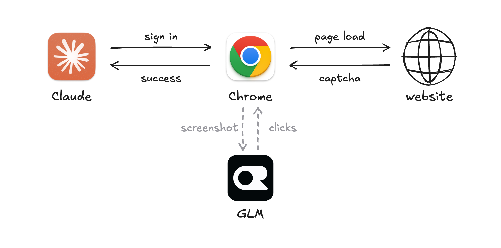

# captcha-proxy



Lets a browser agent get past CAPTCHAs without knowing about them. A stdio MCP
proxy in front of [chrome-devtools-mcp](https://github.com/ChromeDevTools/chrome-devtools-mcp):
after each click, key press or page load it looks for a visible reCAPTCHA or
hCaptcha challenge, or an unticked "I'm not a robot" checkbox. When it finds one,
it solves it with a vision GLM model through OpenRouter before the tool result
goes back. The result gets one added line saying what happened.

- `captcha-proxy.py`: the proxy and the solve loop (screenshot, decide, `click_at`,
  VERIFY, repeat). It counts success by reCAPTCHA's own token, and re-opens a
  challenge that Google rejected and hid.
- `captcha-solve.py`: one round, which sends the screenshot to `z-ai/glm-5.3-flashx`
  and turns the answer into clicks. It also holds `BLOCKLIST`, the sites the proxy
  never solves on. It works as a CLI too: `captcha-solve.py --url <page> <screenshot.png>`.

## Setup

1. **Get an OpenRouter key** at https://openrouter.ai/settings/keys and add a few dollars of credit. A CAPTCHA costs about $0.003 to solve, or about $3–4 per 1,000: each GLM round is about $0.001 and a solve takes 2–6 rounds. A page without a challenge costs nothing. Set it in your shell profile:
   ```sh
   export OPENROUTER_API_KEY=sk-or-...
   ```
2. **Adjust the site blocklist** (optional). The proxy never solves on the built-in `BLOCKLIST` in `captcha-solve.py`: big account sign-ins, payments, government sites and our competitors. To change it, set `CAPTCHA_BLOCKLIST` in your shell profile too:
   ```sh
   export CAPTCHA_BLOCKLIST="default, example.com, login.example.org"   # the built-in list plus 2 sites
   export CAPTCHA_BLOCKLIST="accounts.google.com, slack.com"            # only these 2 sites
   export CAPTCHA_BLOCKLIST=""                                          # no blocklist
   ```
3. **Let Claude Code install the rest.** Paste this prompt:
   ```text
   Set up captcha-proxy for your browser. Clone https://github.com/curusarn/captcha-proxy
   to ~/git/captcha-proxy and install chrome-devtools-mcp (npm). Register a user-scope MCP
   server named chrome-devtools that runs
     python3 ~/git/captcha-proxy/captcha-proxy.py chrome-devtools-mcp --headless --experimentalVision
       --chromeArg="--user-agent=<a normal, non-headless Chrome user agent for my installed Chrome version>"
   with OPENROUTER_API_KEY and CAPTCHA_BLOCKLIST (if set) passed through from my environment.
   Then run
     python3 ~/git/captcha-proxy/selftest.py <that same command>
   and show me its RESULT line. It should say PASS.
   ```
   Restart Claude Code afterwards. From then on, a CAPTCHA in that browser is solved before the tool result reaches Claude.

## Use

```sh
OPENROUTER_API_KEY=sk-or-... python3 captcha-proxy.py \
  chrome-devtools-mcp --headless --experimentalVision \
  --chromeArg="--user-agent=Mozilla/5.0 (Macintosh; Intel Mac OS X 10_15_7) AppleWebKit/537.36 (KHTML, like Gecko) Chrome/156.0.0.0 Safari/537.36"
```

- `--experimentalVision` is required: it provides the `click_at` tool that the proxy clicks with.
- The plain, non-headless user agent is optional but matters: with the headless one,
  Google challenges far more often and rejects more answers.
- `OPENROUTER_API_KEY` stays in the proxy; the MCP and Chrome don't get it.
- `CAPTCHA_BLOCKLIST`: your own blocklist, which replaces the built-in one (examples in Setup, step 2). The word `default` in it keeps the built-in list as well, and an empty value blocks nothing.
- Optional settings: `CAPTCHA_MODEL` (default `z-ai/glm-5.3-flashx`), `CAPTCHA_EFFORT`
  (reasoning effort, default `minimal`, about 4 s a round).
- Log: `~/.cache/captcha-proxy.log`.

Check a setup end to end with `python3 selftest.py <browser MCP command…>`. It opens Google's reCAPTCHA demo page through the proxy, submits the form and passes when Google says "Verification Success".

Python 3 standard library only.

Use it for an agent's normal tasks with your own accounts, never for bulk sign-ups,
scraping or getting around a site's limits. Most sites' terms forbid getting past
their bot checks, and Google and Microsoft lock accounts that sign in through
automation. That is why their sign-ins are on the blocklist.

`docs/flow.png` is rendered from `docs/flow.html` (open it in Chrome, or run Chrome headless with `--screenshot`).
